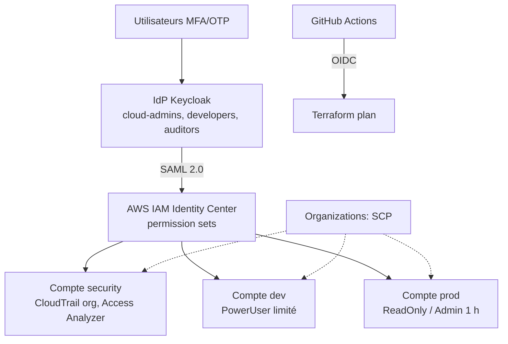

# ☁️ Cloud IAM Zero Trust : Fédération d'identité SSO multi-comptes AWS


> Un fournisseur d'identité unique (IdP) donne accès à plusieurs comptes AWS via SAML, avec MFA obligatoire, moindre privilège, garde-fous organisationnels (SCP), détection d'événements sensibles et déploiement en Infrastructure as Code.

---

## 📑 Sommaire

1. [Contexte](#1-contexte-et-problème-traité) · 2. [Objectifs](#2-objectifs) · 3. [Architecture](#3-architecture) · 4. [Technologies](#4-technologies-utilisées) · 5. [Fonctionnalités](#5-fonctionnalités-et-garde-fous-de-sécurité) · 6. [Phases](#6-plan-de-réalisation-par-phases) · 7. [Structure](#7-structure-du-dépôt) · 8. [Déploiement](#8-déploiement) · 9. [Tests](#9-matrice-de-tests) · 10. [Avant/Après](#10-résultats-avant--après) · 11. [Menaces](#11-modèle-de-menaces) · 12. [Coûts](#12-coûts) · 13. [Limites](#13-limites-connues-et-améliorations) · 14. [Bonnes pratiques](#14-bonnes-pratiques-du-dépôt) · 15. [Ressources](#15-ressources)

---

## 1. Contexte et problème traité

Dans beaucoup d'environnements cloud, les accès sont gérés compte par compte : utilisateurs IAM locaux, clés d'accès longue durée, permissions trop larges, MFA hétérogène et peu de visibilité sur qui peut faire quoi.

Ce projet met en place une approche **centralisée et vérifiable** :

- **une seule identité** par personne, gérée dans l'IdP ;
- **aucun utilisateur IAM local** ni clé longue durée pour les humains (une seule exception documentée : le break-glass) ;
- **accès par rôle** (groupes → permission sets → comptes) ;
- **permissions minimales**, justifiées par l'activité réelle ;
- **traçabilité et alertes** sur les actions sensibles.

## 2. Objectifs

| # | Objectif | Indicateur de réussite |
|---|----------|------------------------|
| 1 | Centraliser l'authentification via un IdP externe | Connexion SSO fonctionnelle sur les 3 comptes |
| 2 | Imposer le MFA | Connexion impossible sans second facteur |
| 3 | Appliquer le moindre privilège | Politiques générées depuis l'activité réelle |
| 4 | Poser des garde-fous organisationnels | SCP testées et documentées |
| 5 | Détecter les actions sensibles | Alertes reçues lors des tests |
| 6 | Tout automatiser | Un déploiement scripté reconstruit l'environnement (hors 2 étapes manuelles documentées) |
| 7 | Prouver l'amélioration | Score Prowler avant/après |

## 3. Architecture



Détails, comptes et points d'attention : [`docs/architecture.md`](docs/architecture.md).

**Flux d'authentification** : portail Identity Center → redirection Keycloak (mot de passe + OTP) → assertion SAML signée → session temporaire sur le compte et le rôle autorisés.

## 4. Technologies utilisées

| Domaine | Outils |
|---------|--------|
| Cloud | AWS Organizations, IAM Identity Center, IAM, CloudTrail, S3, EventBridge, SNS |
| Identité | Keycloak (Docker), option Microsoft Entra ID |
| Analyse des permissions | IAM Access Analyzer (accès externe, accès inutilisé, génération de politiques) |
| IaC | Terraform ≥ 1.10 (verrouillage S3 natif) |
| CI/CD | GitHub Actions avec OIDC |
| Sécurité du code | Checkov, gitleaks |
| Audit | Prowler (benchmark CIS AWS) |

## 5. Fonctionnalités et garde-fous de sécurité

**Identité et accès** : SSO SAML Keycloak ↔ IAM Identity Center ; groupes reliés à des permission sets ; session 1 h pour l'administrateur ; OTP obligatoire côté IdP ; compte break-glass documenté avec alerte.

**Moindre privilège** : politique initiale large (`PowerUser-Dev`) puis remplacement par une politique issue d'Access Analyzer (`Developer-LeastPrivilege`) ; permissions boundaries contre l'escalade ; conditions de région (le MFA n'est conditionnable que pour le break-glass, voir [limites](#13-limites-connues-et-améliorations)).

**SCP** (`policies/scp/`) : interdiction de toucher à CloudTrail ; interdiction du root et de quitter l'organisation ; interdiction des utilisateurs IAM et clés d'accès ; restriction aux régions autorisées.

**Détection** : EventBridge → SNS pour connexion root, console sans MFA, création d'utilisateur IAM, modification de politique, usage du break-glass. Access Analyzer d'organisation (administrateur délégué : compte `security`).

**Automatisation** : tout le périmètre AWS en Terraform ; état S3 chiffré avec verrouillage ; CI `fmt`, `validate`, Checkov, gitleaks, `plan` ; OIDC GitHub → AWS sans clé stockée.

## 6. Plan de réalisation par phases

Durée estimée : **10 à 14 jours à mi-temps**. Guide détaillé : [`docs/deployment-guide.md`](docs/deployment-guide.md).

- [x] **Phase 0 : Préparation** (compte AWS dédié, MFA root, Budgets, dépôt, outils). *Manuel.*
- [x] **Phase 1 : Landing zone** : `terraform/modules/organization`, `organizations-scp`, `org-cloudtrail`.
- [x] **Phase 2 : IdP** : `idp/keycloak/` (compose, realm, scripts).
- [x] **Phase 3 : Fédération SAML** : `modules/identity-center` + 2 étapes manuelles (source d'identité externe, client SAML).
- [x] **Phase 4 : Moindre privilège** : `policies/`, `modules/access-analyzer`, [`docs/least-privilege.md`](docs/least-privilege.md).
- [x] **Phase 5 : MFA et break-glass** : OTP obligatoire dans le realm, [`docs/runbook-break-glass.md`](docs/runbook-break-glass.md).
- [x] **Phase 6 : Audit et détection** : `modules/alerting`, `scripts/run-prowler.sh`.
- [x] **Phase 7 : Terraform et CI/CD** : `.github/workflows/terraform-ci.yml`, `terraform/bootstrap`.
- [ ] **Phase 8 : Tests et preuves** : dérouler la matrice, compléter les résultats, taguer `v1.0`.

> Le code est fourni mais **à exécuter et à valider dans votre compte** : les cases de la phase 8 et les chiffres de la section 10 restent à produire.

## 7. Structure du dépôt

```
cloud-iam-zero-trust/
├── README.md, LICENSE, .gitignore, .checkov.yml, .pre-commit-config.yaml
├── docs/  (architecture, deployment-guide, threat-model, test-matrix,
│           runbook-break-glass, least-privilege, adr/, images/)
├── terraform/
│   ├── bootstrap/                 # bucket d'état + OIDC GitHub (état local, une fois)
│   ├── modules/
│   │   ├── organization/          # organisation + comptes
│   │   ├── organizations-scp/
│   │   ├── org-cloudtrail/        # bucket (security) + trail d'organisation
│   │   ├── identity-center/       # groupes, utilisateurs, permission sets, affectations
│   │   ├── access-analyzer/
│   │   └── alerting/
│   └── environments/lab/
├── idp/keycloak/  (docker-compose[.https].yml, realm-export.json, .env.example)
├── idp/entra-id/                  # option, à compléter
├── policies/  (scp/, permission-sets/, boundaries/, break-glass/)
├── scripts/   (deploy.sh, destroy.sh, create-test-users.sh,
│               configure-aws-saml-client.sh, run-prowler.sh)
├── reports/
└── .github/workflows/terraform-ci.yml
```

## 8. Déploiement

Prérequis : compte AWS dédié avec MFA root ; Terraform ≥ 1.10 ; AWS CLI v2 ; Docker ; (optionnel) un domaine pour exposer Keycloak en HTTPS.

Résumé (ordre complet avec les étapes manuelles : [`docs/deployment-guide.md`](docs/deployment-guide.md)) :

```bash
# 1. Bootstrap état distant + OIDC
cd terraform/bootstrap && terraform init && terraform apply \
  -var state_bucket_name=lab-iam-tfstate-<ID> -var github_repo=<owner>/<repo>

# 2. (manuel) Activer IAM Identity Center dans la console

# 3. IdP
cd idp/keycloak && cp .env.example .env && docker compose up -d && cd ../..
./scripts/create-test-users.sh

# 4. Infrastructure (deux temps automatisés)
cp terraform/environments/lab/terraform.tfvars.example terraform/environments/lab/terraform.tfvars
cp terraform/environments/lab/backend.hcl.example terraform/environments/lab/backend.hcl
./scripts/deploy.sh apply

# 5. (manuel) Source d'identité externe + ./scripts/configure-aws-saml-client.sh
```

Destruction : `./scripts/destroy.sh`.

> ⚠️ Les comptes membres AWS ne se suppriment pas instantanément : `close_accounts_on_destroy` est à `false` par défaut. Consultez la documentation AWS Organizations avant de les fermer.

## 9. Matrice de tests

Procédures complètes et colonnes de preuves : [`docs/test-matrix.md`](docs/test-matrix.md) (11 scénarios, dont les 10 prévus).

## 10. Résultats Avant / Après

| Mesure | Avant | Après |
|--------|-------|-------|
| Score Prowler (CIS) | _à compléter_ | _à compléter_ |
| Contrôles en échec | _à compléter_ | _à compléter_ |
| Actions IAM autorisées (dev) | _à compléter_ | _à compléter_ |
| Utilisateurs IAM locaux | _à compléter_ | 1 (break-glass, documenté) |
| Clés d'accès longue durée | _à compléter_ | 0 |

## 11. Modèle de menaces

Synthèse : MFA côté IdP, aucune clé humaine, boundaries et SCP contre l'escalade, SCP protégeant CloudTrail, Access Analyzer et revues pour les permissions excessives, Terraform + scans pour la dérive. Détails : [`docs/threat-model.md`](docs/threat-model.md).

## 12. Coûts

Conçu pour rester à **quelques euros par mois** : IAM Identity Center, Organizations et IAM sont gratuits ; coûts principaux : stockage CloudTrail/S3, SNS, hébergement de Keycloak, et l'analyseur d'accès inutilisé (payant, désactivable via `enable_unused_access_analyzer = false`). Vérifiez les tarifs actuels et gardez les alertes de budget actives.

## 13. Limites connues et améliorations

**Limites**
- Terraform ne peut pas activer Identity Center ni configurer la source d'identité externe : 2 étapes manuelles.
- Keycloak n'a pas de SCIM natif : provisionnement double (Terraform côté AWS, script côté Keycloak) ; NameID = e-mail à garder identique.
- Les sessions SAML ne portent pas `aws:MultiFactorAuthPresent` : le MFA est appliqué et prouvé côté Keycloak, pas par condition IAM.
- Laboratoire sans haute disponibilité de l'IdP ; Keycloak en mode dev (non durci pour la production).
- Le rôle CI de `plan` peut assumer `OrganizationAccountAccessRole` des comptes membres (voir ADR 0003).
- Alertes déployées en `us-east-1` (évènements globaux) ; les évènements d'autres régions ne sont pas couverts.
- Accès conditionnel et PIM dépendent des licences Entra ID.

**Pistes d'amélioration**
- [ ] Extension Azure (Entra ID, PIM, accès conditionnel)
- [ ] Security Hub et GuardDuty
- [ ] Réponse automatique aux incidents (Lambda)
- [ ] Revues d'accès automatisées
- [ ] Passkeys obligatoires pour les rôles admin
- [ ] Export des logs vers un SIEM (Sentinel, Elastic)
- [ ] Rôles lecture seule dédiés pour la CI dans chaque compte membre

## 14. Bonnes pratiques du dépôt

**Ne jamais commiter** : `.tfstate`, `.tfvars` réels, `backend.hcl`, `.env`, clés, secrets, certificats, identifiants de comptes AWS et e-mails réels (masquez-les dans les captures et les rapports Prowler), exports Keycloak contenant des secrets.

**Conventions** : commits petits par phase (`feat(scp): deny cloudtrail deletion`) ; pull requests même en solo ; branche `main` protégée ; `gitleaks` en pré-commit (`pre-commit install`) ; commiter `.terraform.lock.hcl`.

## 15. Ressources

- [AWS IAM Identity Center](https://docs.aws.amazon.com/singlesignon/)
- [AWS Organizations : Service control policies](https://docs.aws.amazon.com/organizations/latest/userguide/orgs_manage_policies_scps.html)
- [IAM Access Analyzer](https://docs.aws.amazon.com/IAM/latest/UserGuide/what-is-access-analyzer.html)
- [Keycloak Documentation](https://www.keycloak.org/documentation)
- [Prowler](https://github.com/prowler-cloud/prowler)
- [Checkov](https://www.checkov.io/)
- [GitHub Actions : OIDC avec AWS](https://docs.github.com/actions/deployment/security-hardening-your-deployments/configuring-openid-connect-in-amazon-web-services)

---

## 👤 Auteur

**<Votre nom>** · [LinkedIn](https://linkedin.com/in/<profil>) · [GitHub](https://github.com/<compte>)

## 📄 Licence

Distribué sous licence MIT. Voir le fichier `LICENSE`.
