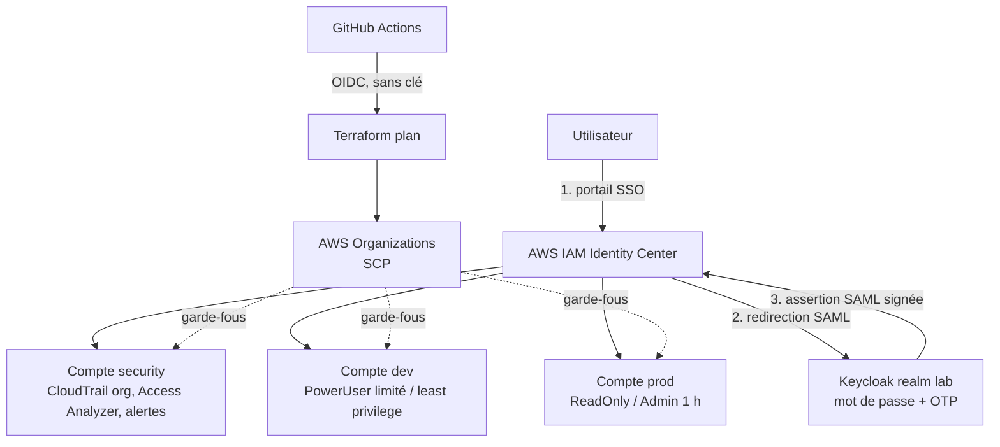

# Architecture

Un export draw.io / Excalidraw peut remplacer ce schéma dans `docs/images/architecture.png`.

## Comptes

| Compte | Rôle |
|--------|------|
| management | Organizations, Identity Center, trail d'organisation, utilisateur break-glass. Aucune charge de travail. Non soumis aux SCP. |
| `<prefix>-security` | Bucket des logs CloudTrail, administrateur délégué d'Access Analyzer. |
| `<prefix>-dev` | Charges de développement. |
| `<prefix>-prod` | Production simulée, accès en lecture par défaut. |

## Flux d'authentification

1. L'utilisateur ouvre le portail IAM Identity Center.
2. Identity Center le redirige (SAML) vers Keycloak : mot de passe puis OTP.
3. Keycloak renvoie une assertion signée dont le NameID est l'e-mail.
4. Identity Center associe le NameID à l'utilisateur de l'Identity Store, résout ses groupes puis ouvre une session
   temporaire (1 h pour Administrator, 4 h sinon) sur le compte et le permission set autorisés.

## Points d'attention (importants)

- **Étapes manuelles** : l'activation d'Identity Center et le choix de la source d'identité externe (échange de métadonnées SAML)
  ne sont pas pilotables par Terraform. Voir `deployment-guide.md`.
- **Provisionnement** : Keycloak n'a pas de SCIM natif. Utilisateurs et groupes sont créés des deux côtés (Terraform côté AWS,
  `scripts/create-test-users.sh` côté Keycloak). Le **NameID = e-mail** doit être identique au `user_name` côté AWS.
- **MFA** : il est appliqué par Keycloak. Les sessions fédérées SAML ne portent pas `aws:MultiFactorAuthPresent`, donc une
  condition IAM sur cette clé ne s'évalue pas comme pour un utilisateur IAM. La condition MFA est utilisée uniquement
  pour le break-glass (utilisateur IAM). Les conditions par région et par tag fonctionnent normalement.
- **Région des alertes** : les évènements IAM, console et root sont journalisés en `us-east-1`. Les règles EventBridge sont donc
  déployées en `us-east-1`, qui doit rester autorisée dans la SCP de régions.
- **Boundary** : le permission set `Developer-LeastPrivilege` utilise `PowerUserAccess` comme boundary ; les rôles que les
  développeurs créent doivent porter la boundary `developer-boundary` (condition `iam:PermissionsBoundary`).
